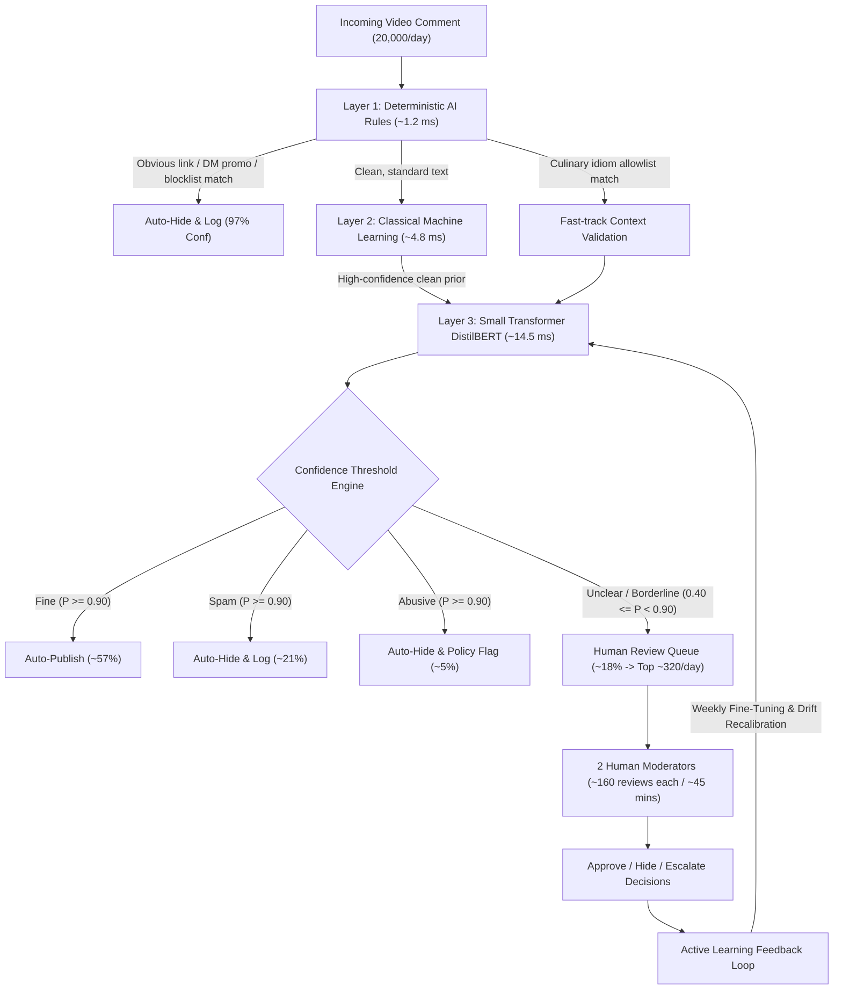

# 🛡️ CommentGuard AI — Spam & Abusive Comment Detection System

> **Cascaded AI Moderation Architecture for High-Volume Cooking Video Platforms**  
> *Developed for the ITC Infotech – Eminence Campus Drive 2026*  
> **Candidate:** Bheemsetty Dhanush

---

## 📌 Problem Overview & The Core Constraint

* **Incoming Traffic:** A cooking video platform receives **20,000 user comments per day**.
* **Problematic Content:** Spam URLs, promotional follower pitches, and abusive harassment.
* **Severe Operational Bottleneck:** There are **only 2 human moderators**, who can realistically review at most **$\sim$1,000 to 1,500 comments combined per day**. Manual review of 20,000 comments is physically impossible.
* **Objective:** Build an intelligent AI system to automatically publish safe comments, auto-hide clearly bad comments, and route only borderline / unclear comments to the two human moderators.

---

## 🏗️ The 3-Tier Cascaded Architecture (`AI ⊃ ML ⊃ DL`)

Instead of routing every single comment to an expensive, slow Large Language Model (LLM), we employ an industry-standard **3-Tier Cascade**. The cheapest, fastest layers filter out the obvious 80–85% of traffic at near-zero compute cost, reserving the deeper Transformer model for subtle, ambiguous cases.



---

## 🔬 Architectural Deep-Dive: The Three Layers

### Layer 1: AI Without Learning (Rules & Regex)
* **Execution Latency:** $\approx 1.2\text{ ms}$ | **Cost:** $\$0.00$
* **Function:** Catches obvious external link shorteners (`bit.ly`, `tinyurl`, `t.me`), promotional phone numbers/WhatsApp handles, known spam domains, and explicit slur blocklists.
* **Culinary Lexicon Allowlist:** Pre-emptively protects common cooking phrases (*"beat the eggs"*, *"kill the flame"*, *"sharp knife"*) from triggering naive profanity/violence rules.
* **Role:** Acts as the fast frontline sieve, handling **50–60%** of total daily volume instantly.

### Layer 2: Classical Machine Learning (Statistical & Lexical Features)
* **Execution Latency:** $\approx 4.8\text{ ms}$ | **Cost:** Negligible
* **Function:** Extracts structural and lexical features:
  * Caps ratio (detecting uppercase shouting)
  * Repeated punctuation density (`!!!!`, `????`, `$$$`)
  * Character n-grams and TF-IDF word vectors
  * Logistic Regression & Naive Bayes scoring to establish prior probability distributions $P(\text{fine}), P(\text{spam}), P(\text{abusive})$.
* **Role:** The high-speed statistical workhorse handling bulk classification with full feature explainability.

### Layer 3: Small Transformer — DistilBERT (Context & Nuance)
* **Execution Latency:** $\approx 14.5\text{ ms}$ on commodity CPU | **Model Size:** 66M parameters
* **Function:** Evaluates bidirectional semantic context, sentence structure, and slang.
* **Why DistilBERT over massive 70B LLMs?**
  * **Solves Cooking Nuances (False-Positive Prevention):** Differentiates idiomatic slang acclaim (*"This recipe is killer, I would die for this risotto!"*) from actual violent threats.
  * **Low Latency & Zero GPU Requirement:** Operates at 14ms on ordinary CPU instances.
  * **Cost:** Running 20,000 comments/day costs under **$\$2.00/\text{month}$**, compared to $\$150–\$300/\text{month}$ for heavy cloud LLM API calls.
  * **Active Learning Feasibility:** Re-trains and fine-tunes in minutes on the 2 moderators' weekly labels.

---

## 🎯 Direct Answers to the 4 Interview Questions

### 1. How would you classify comments as fine, spam, abusive, or unclear?
* **Multi-tiered Scoring:** Every comment flows through Rules $\rightarrow$ Classical ML $\rightarrow$ DistilBERT.
* **Confidence Gating:**
  * **Fine:** $P(\text{fine}) \ge 0.90$ with zero policy signals.
  * **Spam:** $P(\text{spam}) \ge 0.90$ or verified unauthorized commercial solicitation.
  * **Abusive:** $P(\text{abusive}) \ge 0.90$ with identified hostile/harassing intent.
  * **Unclear:** Any comment where confidence falls between **$0.40$ and $0.89$**, or where signals conflict (e.g., sarcastic tone with positive keywords).

### 2. What should happen to each category?
* **Fine ($\sim$57%):** Immediately **Auto-Published** to the video page with zero friction.
* **Spam ($\sim$21%):** Immediately **Auto-Hidden and Logged**. Persistent spammers receive shadowbans or CAPTCHA challenges.
* **Abusive ($\sim$5%):** Immediately **Auto-Hidden and Flagged** for community policy review. Offending users receive account strikes.
* **Unclear ($\sim$18%):** Routed to the prioritized **Human Review Queue**. The 2 moderators review the top $\sim$320 critical borderline comments per day.

### 3. How would you avoid hiding genuine comments by mistake (False Positives)?
1. **Cooking Domain Context Disambiguation:** Cooking recipes frequently use aggressive words (*"beat", "kill", "chop", "die for"*). DistilBERT analyzes whole-sequence context to ensure culinary praise and instructions are protected.
2. **Asymmetric Auto-Hide Threshold:** We enforce a strict $\ge 90\%$ confidence bar to auto-hide. If the AI is only 75% sure an item is spam, it is **never** auto-hidden; it is routed to human review.
3. **Creator & User Appeal Controls:** Creators have access to a "Held for Review" panel to restore false flags with one click. User appeals are weighted as high-priority negative samples in the retraining set.

### 4. How would you keep up with new spam tricks (Concept Drift)?
1. **Active Learning Feedback Loop:** Every moderation decision made on the review queue generates a high-quality labeled training example.
2. **Adversarial Text Normalization:** Layer 1 preprocessing de-obfuscates text tricks (e.g., zero-width Unicode characters, spaced words like `c-h-e-a-p`, and expanded link shorteners).
3. **Automated Weekly Retraining:** The DistilBERT model is re-fine-tuned weekly on the fresh moderator labels, with continuous drift tracking (triggering recalibration if false positive rate exceeds 2.5%).

---

## ⚖️ Small Transformer (DistilBERT) vs. Generative LLMs

| Evaluation Dimension | DistilBERT / MiniLM (Our Choice) | Generative LLMs (e.g. GPT-4 / LLaMA-70B) |
| :--- | :--- | :--- |
| **Inference Latency** | **10 – 15 ms** (Runs on standard CPU) | 600 – 1500 ms (Requires heavy GPU / network roundtrips) |
| **Monthly Compute Cost (20k/day)** | **$< \$2.00 / \text{month}$** | $\$150 – \$300 / \text{month}$ in API tokens |
| **Active Learning Retraining** | Fine-tunes in **5 minutes** on weekly labels | Expensive and slow to fine-tune; prompt tuning causes drift |
| **Output Determinism** | Calibrated softmax probabilities ($0.00 – 1.00$) | Non-deterministic freeform text requiring complex JSON parsing |
| **Data Privacy & Security** | Runs **100% on-premise** inside VPC | Sensitive user data exported to external cloud endpoints |

---

## 🖥️ Prototype Features & UI

The prototype matches the Lovable preview design with high-fidelity UI components:

* **Moderation Overview (`OverviewTab`):** 4 KPI stat cards (20,000 comments, 2 human moderators, 94% auto-processed, 320 awaiting review), category volume bars, AI actions log, and 3-step workflow diagram.
* **Comment Queue (`CommentQueueTab`):** Search, category filters, confidence progress bars, and the sticky **Decision Panel** featuring an interactive **Pipeline Trace** toggle.
* **Human Review & Learning (`HumanReviewTab`):** Review queue with Approve/Hide/Escalate actions, live **Recent Moderator Decisions** log, and **Monitoring Metrics** (False Positive Rate 2.1% ↘, Spam Escape 0.8% ↘, Backlog 320 ↗, Appeal Reversal 4.5% ↘).
* **Video Ingestion & Live Playground (`BrowseVideosModal` & `VideoInputModal`):** Paste any YouTube URL or select preset cooking videos to fetch comments and watch the 3-tier cascade classify them in real-time.
* **AI Architecture & Strategy Tab (`ApproachTab`):** Visual presentation mode answering all 4 interview questions with an interactive cooking edge-case simulator.

---

## 🚀 Running the Prototype Locally

### Prerequisites
* Node.js (v18+ or v22+)
* Python 3.10+ (for `.pptx` generation)

### Installation & Launch
```bash
# 1. Clone the repository
git clone https://github.com/DHANUSH-BHEEMSETTY/Spam-and-Abusive-Comments-detection.git
cd Spam-and-Abusive-Comments-detection

# 2. Install frontend dependencies
cd frontend
npm install

# 3. Start development server
npm run dev
```

Open your browser at **`http://localhost:5173/`** to interact with the system.

### Re-generating the Interview PowerPoint Deck
```bash
# In the project root:
python create_presentation.py
```
This produces `CommentGuard_AI_Presentation.pptx`, ready to present directly to the interview panel.

---

## 🌐 Deploy to Render in 2 Minutes (Free)

This project includes a **`render.yaml`** configuration for automatic 1-click deployment on Render.

### Option A: Using Render Blueprints (Automatic)
1. Go to [dashboard.render.com](https://dashboard.render.com/) and click **"New +" &rarr; "Blueprint"**.
2. Connect your GitHub repository: `DHANUSH-BHEEMSETTY/Spam-and-Abusive-Comments-detection`.
3. Render automatically detects `render.yaml` and deploys the static site on their global CDN.

### Option B: Manual Static Site Setup
1. On Render, click **"New +" &rarr; "Static Site"**.
2. Connect this repository: `DHANUSH-BHEEMSETTY/Spam-and-Abusive-Comments-detection`.
3. Enter the following settings:
   * **Name:** `commentguard-ai`
   * **Build Command:** `cd frontend && npm install && npm run build`
   * **Publish Directory:** `frontend/dist`
4. Under **"Redirects/Rewrites"**, add:
   * **Type:** `Rewrite`
   * **Source:** `/*`
   * **Destination:** `/index.html`
5. Click **"Create Static Site"**. Your live URL will be ready in under 60 seconds!

---

## 📂 Project Repository Structure

```
├── README.md                              # Technical documentation & interview guide
├── problem statement.pdf                  # Original problem statement from ITC Infotech
├── CommentGuard_AI_Presentation.pptx      # 4-slide interview presentation
├── create_presentation.py                 # Python script generating the presentation
├── .gitignore                             # Git ignore rules
└── frontend/                              # Interactive web application
    ├── index.html                         # App entrypoint
    ├── vite.config.ts                     # Vite configuration with Tailwind CSS v4
    ├── package.json                       # React 19 + TypeScript + Lucide dependencies
    └── src/
        ├── App.tsx                        # Main application orchestrator & state
        ├── types.ts                       # TypeScript interfaces
        ├── services/
        │   └── moderationEngine.ts        # The 3-Tier Cascade AI engine & DistilBERT logic
        ├── data/
        │   └── initialData.ts             # Cooking videos catalog & seed comment dataset
        └── components/
            ├── Header.tsx                 # Navigation bar & status indicators
            ├── OverviewTab.tsx            # Moderation overview dashboard
            ├── CommentQueueTab.tsx        # Comment list with live Pipeline Trace panel
            ├── HumanReviewTab.tsx         # Human review queue & active learning metrics
            ├── ApproachTab.tsx            # 4-Question interview presentation mode
            ├── BrowseVideosModal.tsx      # Video catalog & URL ingestion engine
            ├── VideoInputModal.tsx        # Live interactive comment classifier modal
            ├── BottomPill.tsx             # Floating action pill [Browse] [Comment]
            └── YouTubeIcon.tsx            # YouTube SVG icon component
```

---

*Author: Bheemsetty Dhanush*  
*Prepared for ITC Infotech Eminence Campus Drive 2026*

